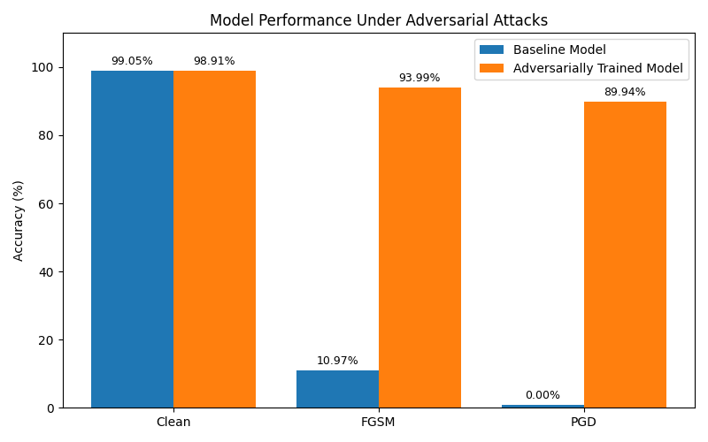

# Adversarial Defence of Convolutional Neural Networks

## Overview

This project was developed as part of my final-year undergraduate dissertation in Cybersecurity and Forensics.

It investigates the vulnerability of convolutional neural networks (CNNs) to adversarial attacks and evaluates the effectiveness of adversarial training as a defence mechanism.

## Technologies Used

- Python
- PyTorch
- Torchvision
- Matplotlib
- MNIST dataset

## Features

- Convolutional neural network for handwritten digit classification
- Fast Gradient Sign Method (FGSM) attack
- Projected Gradient Descent (PGD) attack
- Adversarial training
- Model performance evaluation
- Comparative results visualisation

## Project Structure

- `attacks/` - FGSM and PGD implementations
- `defenses/` - Adversarial training
- `evaluation/` - Model evaluation scripts
- `models/` - CNN architecture
- `train.py` - Baseline model training
- `plot_results.py` - Results visualisation

## Experimental Results

| Test | Baseline Model | Defended Model |
|---|---:|---:|
| Clean images | 99.05% | 98.91% |
| FGSM | 10.97% | 93.99% |
| PGD | 0.00% | 89.94% |

The results demonstrate improved resistance to the tested adversarial attacks while maintaining high classification accuracy on clean images.

These findings are specific to the experimental conditions used in this project.

## What I Learned

- Python programming and modular code organisation
- Neural network training and evaluation
- Adversarial machine learning
- Debugging and iterative testing
- Data analysis and visualisation

## Project Status

Completed academic research project. Further improvements could include additional testing, documentation and evaluation against other datasets and attack methods.
